# IskrCLOCK v6.2

Онлайн-будильник с радио и живым пейзажем. Всё приложение — одна страница: будильники, таймер, секундомер, станции и калькулятор сна переключаются без перезагрузки, радио при этом не прерывается.

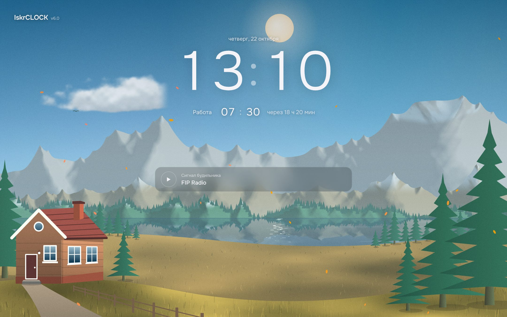

## ✨ Возможности

### ⏰ Будильники
- Сколько угодно будильников: у каждого своё название, время, дни недели, станция, «подремать» и нарастание громкости
- Будильник без выбранных дней звонит один раз и выключается
- Общая громкость, плавное нарастание за 30 секунд
- Экран не гаснет, пока есть включённый будильник (Wake Lock API)
- **🛡️ Отказоустойчивость** — при обрыве или зависании потока будильник сначала ~15 секунд переподключается и только потом включает резервный сигнал; попытки продолжаются в фоне, и как только поток восстановится, снова играет радио

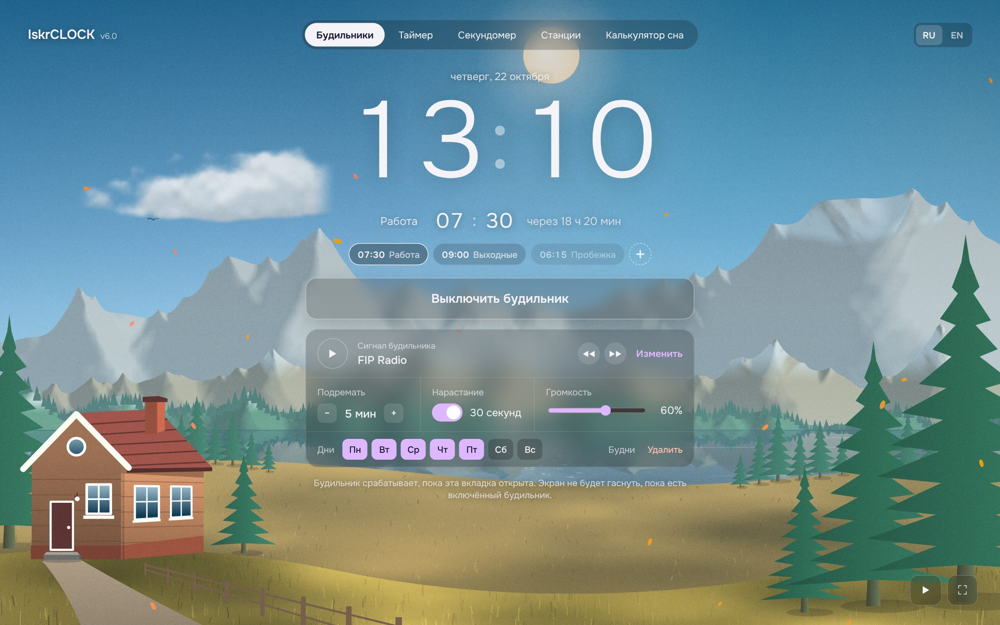
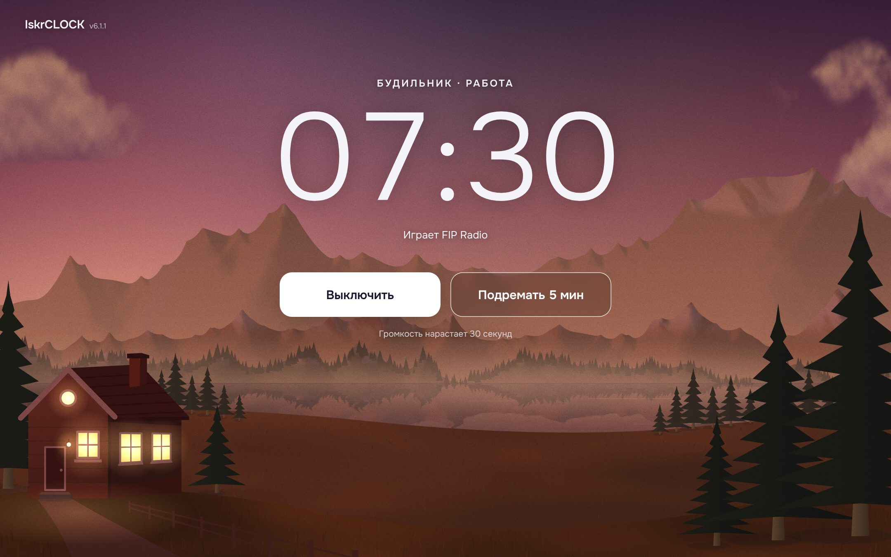

### 🎵 Станции и плейлисты
- 17 встроенных радиостанций и классический сигнал, который работает без интернета; при первом заходе выбрано «Эрмитаж FM»
- Один плеер на все вкладки: где бы вы ни были, видно, что играет, а при наведении всплывает громкость
- Свои станции из ссылок на потоки (MP3/AAC/OGG/HLS `.m3u8`), плейлистов `.m3u`/`.pls`, локальных файлов (MP3/FLAC/WAV/OGG/OPUS/M4A, до 350 МБ) и YouTube (видео и плейлисты)
- Форматы можно смешивать в одном плейлисте; порядок, «Перемешать» и «По кругу» настраиваются в редакторе
- Станции, созданные в прошлых версиях, переносятся автоматически

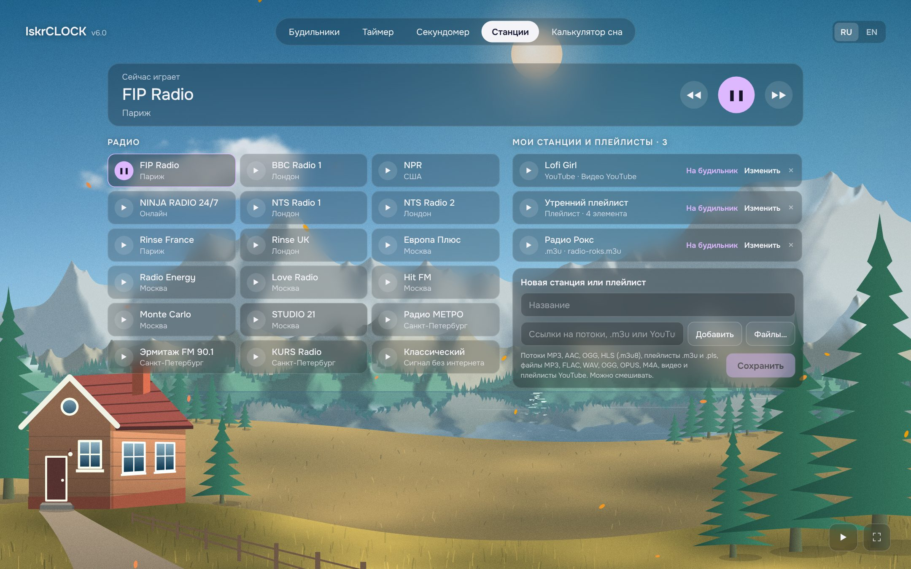
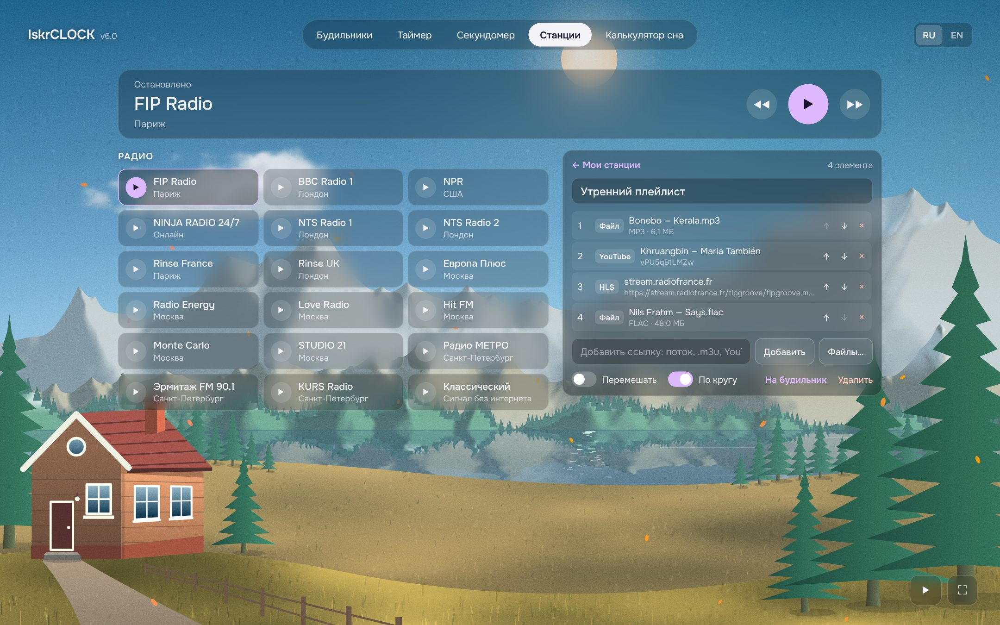

### ⏲️ Таймер, ⏱️ секундомер, 🧮 калькулятор сна
- **Таймер** — пресеты, свой сигнал по окончании, точный даже в фоновой вкладке; Пробел — старт/пауза, R — сброс
- **Секундомер** — круги с лучшим и худшим, музыка во время отсчёта, переживает перезагрузку; Пробел, L — круг, R — сброс
- **Калькулятор сна** — когда лечь или встать с учётом 90-минутных циклов, будильник в один клик
- Запущенные таймер и секундомер видны в шапке из любого раздела

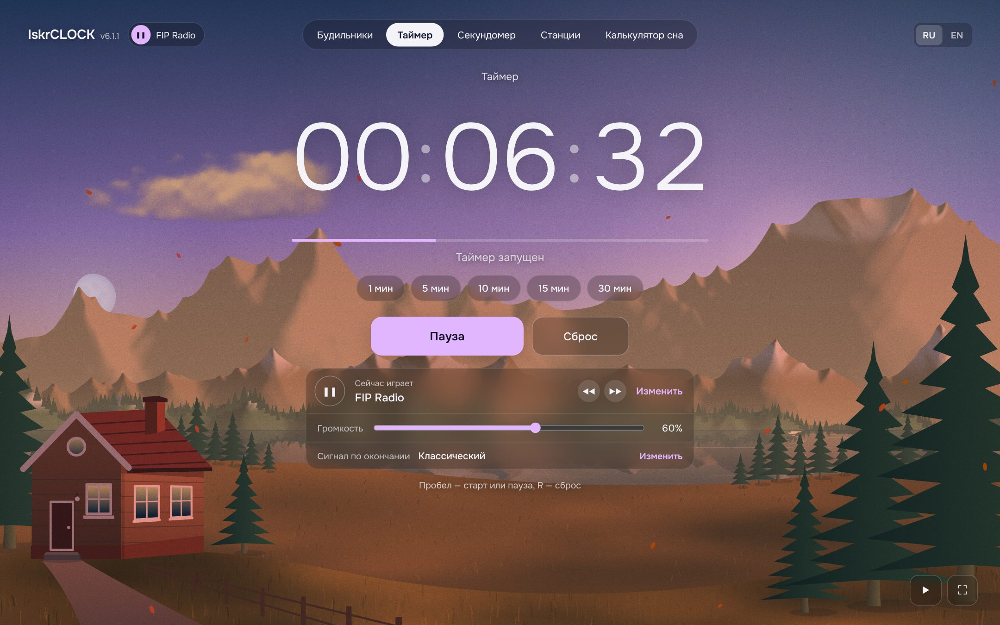
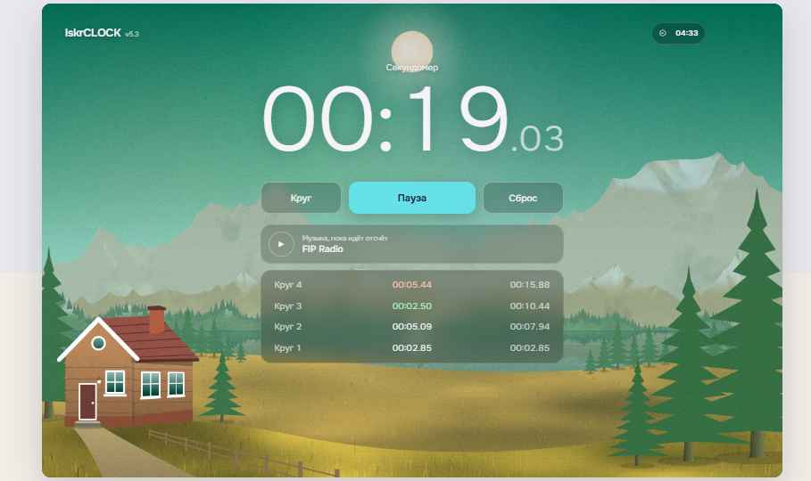
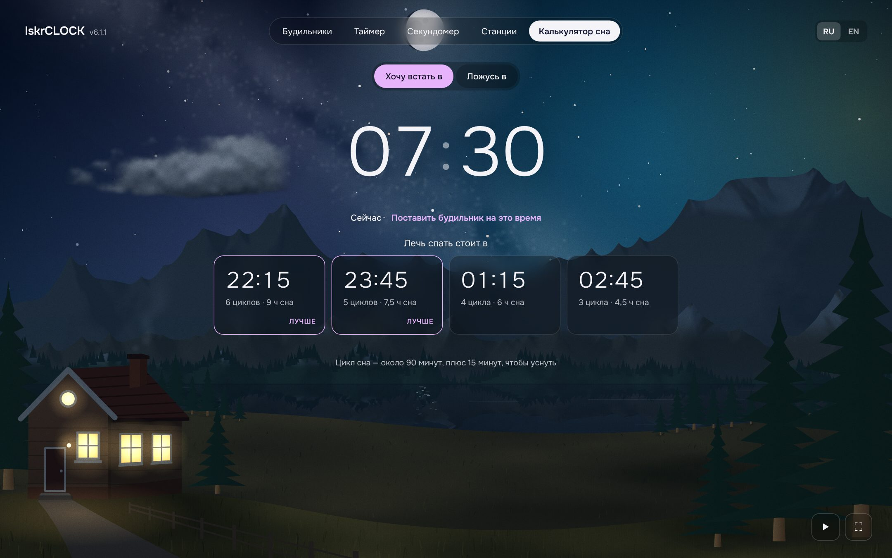

### 🏔️ Живой пейзаж
Фон рисуется на canvas и меняется в реальном времени: время суток, своя палитра на каждый день года, сезоны, настоящая фаза луны, снег зимой и новогоднее оформление. Пока играет музыка, вода светится под неё, как отражение эквалайзера (для станций, чей звук доступен странице: свои файлы, HLS, потоки с CORS). Кнопка «Демо» в правом нижнем углу прокручивает год и сутки.

| Вечер | Новый год |
|---|---|
| 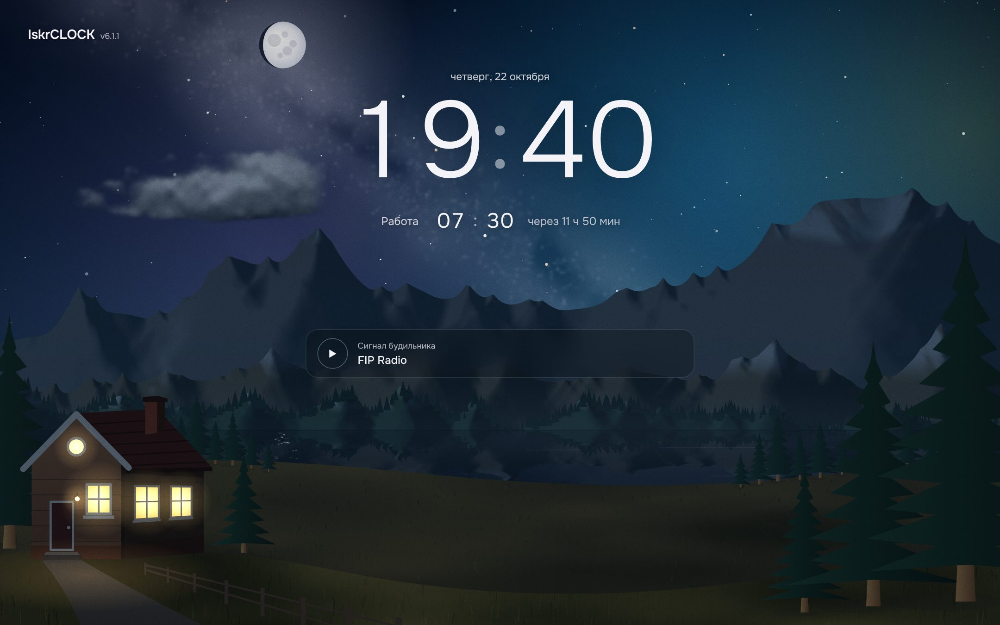 | 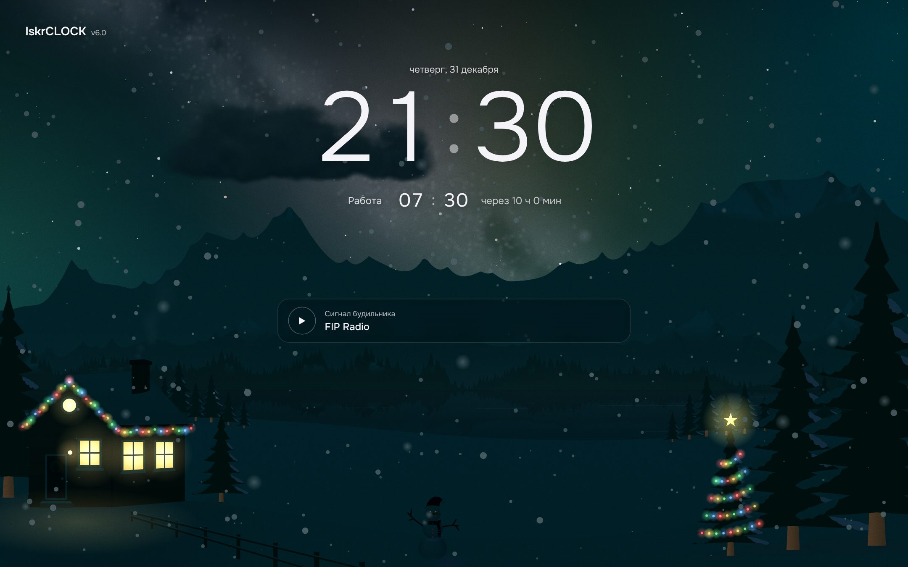 |
| **Летний рассвет** | **Зимняя ночь** |
| 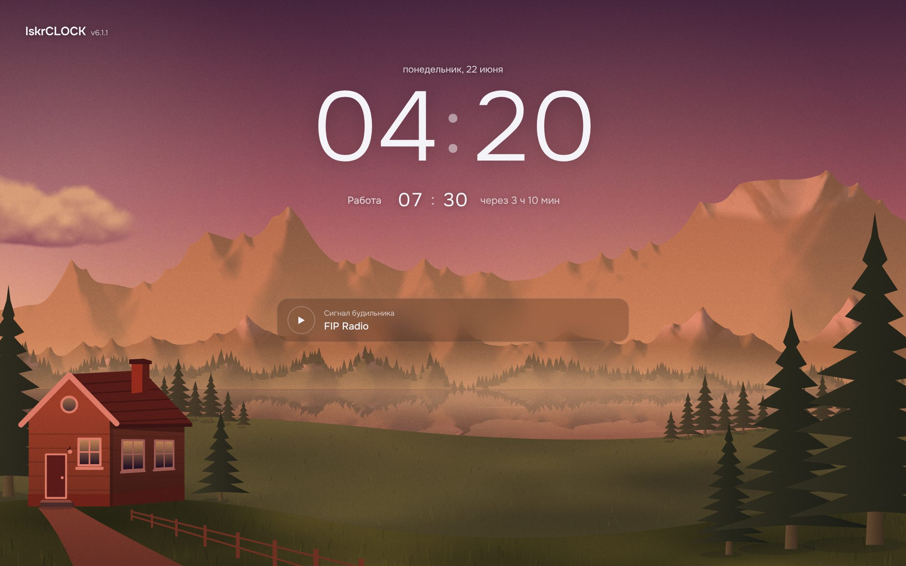 | 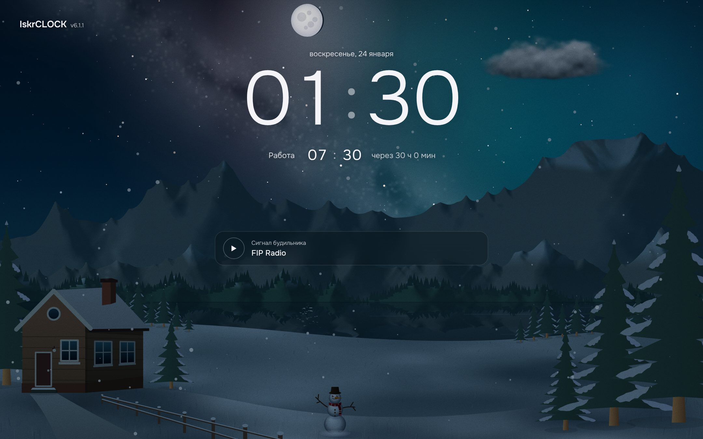 |

### 📱 На телефоне
Вкладки — нижняя панель со значками, управление показывается по касанию и само сворачивается через 10 секунд или по касанию пустого места, пейзаж кадрируется так, чтобы были видны дом и деревья.

| Будильники | Станции |
|---|---|
| 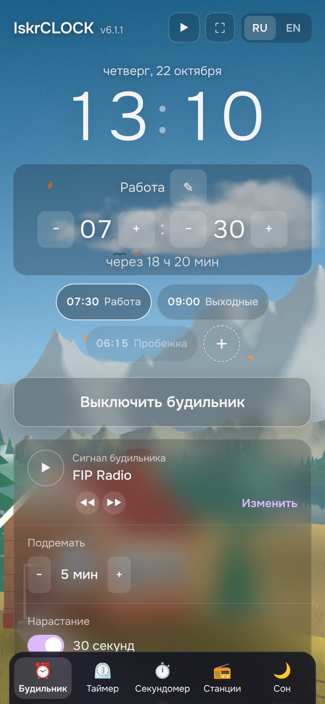 | 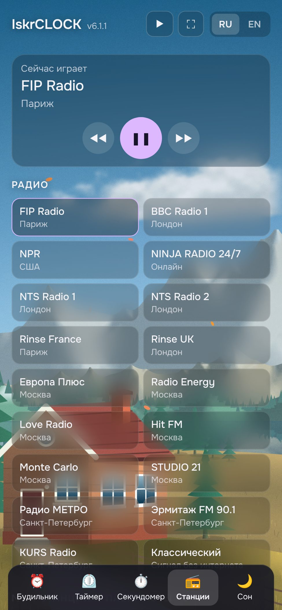 |

### 🌐 Языки
Русский и английский, выбор сохраняется.

## 🚀 Технологии

- Чистые HTML, CSS и JavaScript, без сборки
- **`<iskr-sky>`** — web component с пейзажем на canvas
- **HLS.js** — HLS-потоки (с запасным CDN и нативным HLS в Safari)
- **IndexedDB** — локальные аудиофайлы
- **YouTube IFrame API** — видео и плейлисты YouTube
- **Web Audio API** — резервный сигнал без интернета

## 📦 Структура

```
iskrclock/
├── index.html              # Приложение (все разделы)
├── app.css                 # Стили
├── app.js                  # Интерфейс, будильники, таймер, секундомер, калькулятор сна
├── media.js                # Станции, хранилище, миграция, движок воспроизведения
├── iskr-sky.js             # Живой пейзаж <iskr-sky>
├── timer.html, stopwatch.html, custom-stations.html, sleep-calculator.html
│                           # Перенаправления со старых адресов на разделы (#timer и т. д.)
├── screenshots/
├── README.md
└── CHANGELOG.md
```

Разделы открываются по адресам `index.html#alarms`, `#timer`, `#stopwatch`, `#stations`, `#sleep`.

## 🎯 Использование

1. Откройте `index.html` в браузере
2. Наведите курсор на часы и настройте время будильника кнопками «−» и «+»
3. Наведите на плеер, чтобы выбрать станцию, дни, громкость и нарастание
4. Нажмите «Включить будильник» и оставьте вкладку открытой

## 📝 Лицензия

MIT

## 🔗 Ссылки

- GitHub: https://github.com/Iskr/iskrclock
- Live Demo: https://iskr.github.io/iskrclock/
